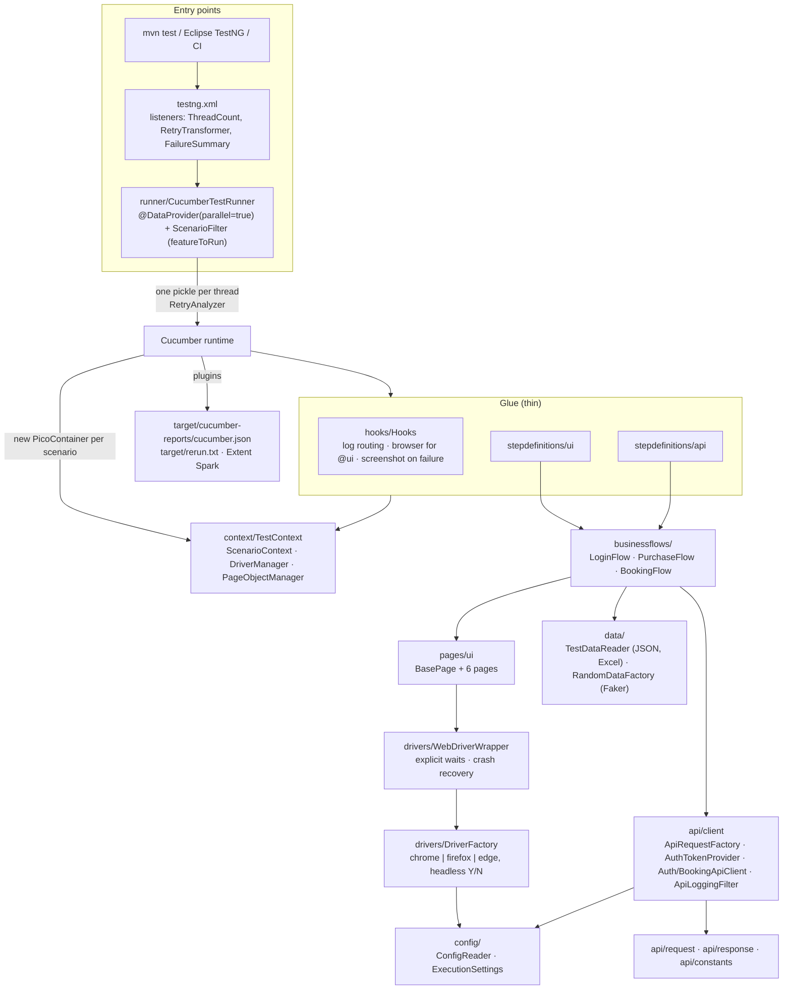

# QA Automation Framework: UI + API, Selenium 4 · REST Assured · Cucumber 7 · TestNG

**Author:** Ravi Sai Saridevi, Senior QA Engineer

> **30-second pitch.** This is a layered BDD framework that tests a web shop UI ([SauceDemo](https://www.saucedemo.com))
> and a REST API ([Restful Booker](https://restful-booker.herokuapp.com)) from one Maven project. Scenarios run in
> parallel threads, and CI also spreads them across parallel jobs. A custom TestNG runner selects scenarios by
> test-case ID (`-DfeatureToRun="+TC-UI-001,+TC-API-002"`). Browser crashes are retried automatically. Real failures
> are only retried if you opt in. Every scenario carries a test-case ID that maps 1:1 to a test-management tool.
> Nothing is shared between threads: PicoContainer gives each scenario its own browser, pages, API clients and state.

Both applications are public practice sites built for automation training. The credentials used are their published
demo credentials, and they are still read from environment variables, as a real project would do.

---

## Contents

1. [What is covered](#what-is-covered)
2. [Tech stack](#tech-stack)
3. [Architecture](#architecture)
4. [Layer by layer](#layer-by-layer)
5. [Execution flow, step by step](#execution-flow-step-by-step)
6. [Retry strategy](#retry-strategy)
7. [Parallelism: threads and CI shards](#parallelism-threads-and-ci-shards)
8. [Test data and secrets](#test-data-and-secrets)
9. [Traceability: test-case tags](#traceability-test-case-tags)
10. [How to run](#how-to-run)
11. [Eclipse setup](#eclipse-setup)
12. [Reports](#reports)
13. [CI/CD](#cicd)
14. [Design decisions and trade-offs](#design-decisions-and-trade-offs)

---

## What is covered

| Area | Test cases | Highlights |
|---|---|---|
| UI · Login | TC-UI-001 … 004 | standard, locked-out and problem users; Scenario Outline for invalid input |
| UI · Cart | TC-UI-005 … 008 | add one or many (data table), remove from the products page and from the cart page |
| UI · Sorting | TC-UI-009 … 011 | price ascending/descending, name Z→A |
| UI · Checkout | TC-UI-012 … 013 | full purchase with **JavaFaker** customer data and a total + 8% tax check; form validation driven by **Excel** |
| API · Auth | TC-API-001 … 002 | token creation; wrong credentials (the API returns 200 + `"reason": "Bad credentials"`) |
| API · Booking | TC-API-003 … 009 | create (JSON test data), get, update and delete with a token; 403 without a token; 404 for an unknown ID |

22 test cases, or 26 scenario executions once Scenario Outline examples are expanded.

## Tech stack

| Concern | Choice |
|---|---|
| Language / build | Java 17, **Maven** |
| UI | Selenium 4.27, with drivers resolved by **Selenium Manager** (no driver binaries, no WebDriverManager) |
| API | REST Assured 5.5 + Jackson (records as request/response POJOs) |
| BDD / runner | Cucumber 7.20 + TestNG 7.10, with a custom data-provider runner |
| Dependency injection | PicoContainer (`cucumber-picocontainer`), scoped per scenario |
| Test data | JSON (Jackson), Excel (Apache POI 5.3), random data (JavaFaker 1.0.2) |
| Reporting | Cucumber JSON/HTML, ExtentReports Spark, Masterthought `maven-cucumber-reporting`, CSV failure summary |
| Logging | Log4j2, with one log file per scenario (RoutingAppender on the ThreadContext) |
| CI | GitHub Actions (PR smoke + sharded nightly regression), Jenkins declarative pipeline |

---

## Architecture



The same structure as ASCII, for viewers that do not render Mermaid:

```
 mvn / Eclipse / CI
        │
   testng.xml ── listeners: ThreadCountListener · RetryAnnotationTransformer · FailureSummaryListener
        │
   CucumberTestRunner ── @DataProvider(parallel) ── ScenarioFilter(-DfeatureToRun) ── RetryAnalyzer
        │  (one scenario per thread, one PicoContainer per scenario)
        ▼
   Hooks ─ StepDefinitions(ui|api) ──► BusinessFlows ──► Pages(ui) ──► WebDriverWrapper ──► DriverFactory
        │                                   │
        └──────────── TestContext ◄─────────┼──► ApiClients ──► RequestSpec + LoggingFilter + Token
              (ScenarioContext,             └──► TestDataReader / RandomDataFactory
               DriverManager,                         │
               PageObjectManager)                ConfigReader (-D > config-<env> > config.properties; secrets = env vars)
```

### Project tree

```
qa-automation-framework/
├── .github/workflows/tests.yml        PR smoke + nightly/manual sharded regression
├── Jenkinsfile                        BROWSER / FEATURE_TO_RUN / THREAD_COUNT / ENV / IS_RETRY
├── pom.xml  ·  testng.xml  ·  .env.example  ·  .gitignore
├── scripts/
│   ├── shard_tests.py                 @TC tags -> JSON matrix (regression | custom | failed)
│   └── verify_results.py              CI gate: cucumber.json present and non-empty, zero TestNG failures
├── docs/INTERVIEW_NOTES.md
└── src/test/
    ├── java/com/qa/framework/
    │   ├── runner/          CucumberTestRunner, ScenarioFilter
    │   ├── context/         TestContext, ScenarioContext, ContextKey
    │   ├── managers/        DriverManager, PageObjectManager
    │   ├── drivers/         DriverFactory, WebDriverWrapper, BrowserType
    │   ├── pages/ui/        BasePage, Login, Inventory, Cart, CheckoutInformation/Overview/Complete
    │   ├── businessflows/   LoginFlow, PurchaseFlow, BookingFlow, FlowPreconditions
    │   ├── stepdefinitions/ ui/ (Login, Cart, Inventory, Checkout)   api/ (Auth, Booking, CommonApi)
    │   ├── api/             client/  request/  response/  constants/
    │   ├── retry/           RetryAnalyzer, RetryAnnotationTransformer, BrowserCrashSignatures
    │   ├── data/            TestDataReader, RandomDataFactory, UserAccount, CheckoutCustomer, CheckoutDataRow
    │   ├── config/          ConfigReader, ExecutionSettings
    │   ├── hooks/           Hooks
    │   ├── listeners/       FailureSummaryListener, ThreadCountListener
    │   └── utils/           WaitUtils, ScreenshotUtils, TagUtils, ScenarioNames
    └── resources/
        ├── features/ui/*.feature  features/api/*.feature
        ├── testdata/        users.json, bookings.json, checkout-data.xlsx
        ├── config.properties, config-qa.properties, config-staging.properties
        └── cucumber.properties, extent.properties, extent-config.xml, log4j2.xml
```

---

## Layer by layer

| Layer | Responsibility | Rules it follows |
|---|---|---|
| **runner/** | `CucumberTestRunner` drives `TestNGCucumberRunner` directly instead of extending `AbstractTestNGCucumberTests`. Its `@DataProvider(parallel = true)` returns the scenario rows after `ScenarioFilter` has applied `-DfeatureToRun`. `runScenario` declares `RetryAnalyzer`. | The filter uses OR semantics, accepts a `+` or `@` prefix, is case-insensitive, and de-duplicates on feature URI + line. If nothing matches, the run fails with a clear message instead of passing with zero tests. |
| **context/** | `TestContext` is the root of the per-scenario object graph. `ScenarioContext` is an `EnumMap` keyed by `ContextKey`, with typed getters that fail clearly when a value is missing or has the wrong type. | Created by PicoContainer for each scenario. **No static mutable state anywhere in the code base.** |
| **managers/** | `DriverManager` owns one browser. `PageObjectManager` creates each page lazily, once per scenario. | `PageObjectManager` belongs to `TestContext` and is deliberately *not* a singleton. `DriverManager` needs no `ThreadLocal`, because Pico scopes it per scenario and a scenario never changes thread. |
| **drivers/** | `DriverFactory` handles chrome/firefox/edge (`-Dbrowser`) and headless mode (`-DisHeadless=Y/N`), with drivers from Selenium Manager. `WebDriverWrapper` provides safe click/type/read/select/wait operations, each running through `execute()` with crash recovery. | Implicit wait is 0 and every wait is explicit. There is no `Thread.sleep`. Pages never touch the raw `WebDriver`. |
| **pages/ui/** | Locators plus page behaviour. `BasePage` receives the `WebDriverWrapper` and the Cucumber `Scenario`, and attaches evidence such as the price list read or the confirmation screenshot. | Pages do not assert. They return state, and steps assert on it. |
| **businessflows/** | Multi-step journeys: `LoginFlow` (alias → JSON user + secret password), `PurchaseFlow` (cart → checkout → overview → finish, with totals stored in context), `BookingFlow` (API lifecycle). | Flows check their own *preconditions* and fail with "Precondition failed: …". *Business* assertions stay in Then steps, so a broken setup is never reported as a product bug. |
| **stepdefinitions/** | Thin glue: parse the step text, call a flow or page, assert. | Every Gherkin step matches exactly one definition (checked, see Verification). |
| **api/** | `client/`: `ApiRequestFactory` builds the base spec per scenario (base URI, JSON, timeouts, `ApiLoggingFilter`). `AuthTokenProvider` fetches the token lazily and caches it per scenario. `AuthApiClient` and `BookingApiClient` have one method per endpoint. `request/`: records and `BookingRequestBuilder`. `response/`: records with `@JsonIgnoreProperties(ignoreUnknown = true)`. `constants/` holds endpoints and headers. | RestAssured's static defaults are never mutated, because they would be shared across threads. Passwords and tokens are masked in logs, in attachments and in `toString()`. |
| **retry/** | `RetryAnalyzer` (two budgets), `BrowserCrashSignatures` (a narrow list, matched across the whole cause chain), `RetryAnnotationTransformer`. | See [Retry strategy](#retry-strategy). |
| **data/** | `TestDataReader` reads JSON and Excel from `src/test/resources/testdata`. `RandomDataFactory` wraps JavaFaker and is injected per scenario. | Passwords are not test data and come from secrets. |
| **config/** | `ConfigReader` resolves `-D` first, then `config-<env>.properties`, then `config.properties`. `secret()` reads **environment variables only**. `ExecutionSettings` validates `threadCount`, `featureToRun`, `isRetry` and `retryCount`. | Loaded once into an unmodifiable map. Missing keys or secrets fail fast and say how to fix them. |
| **hooks/** | Sets the scenario on `TestContext`. Routes logs to `target/logs/scenarios/<TC-id>_<name>.log`. Starts the browser **only for `@ui`**. On failure, attaches a screenshot and the URL, then always quits the browser. | API scenarios never open a browser. |
| **listeners/** | `ThreadCountListener` (an `IAlterSuiteListener` that sizes the data-provider pool). `FailureSummaryListener` writes `target/failure-summary.csv` with the scenario, its tags and the first line of the error. | Only *final* failures are listed. TestNG records retried attempts as skipped. |
| **utils/** | `WaitUtils`, `ScreenshotUtils`, `TagUtils` (TC-ID extraction, file-safe names), `ScenarioNames` (pickle data from a TestNG result). | Stateless. |

---

## Execution flow, step by step

1. `mvn clean test -DfeatureToRun="+TC-UI-001,+TC-API-002" -DthreadCount=3` runs. Surefire forwards every `-D` user property to the forked test JVM.
2. Surefire loads `testng.xml`. **`ThreadCountListener.alter()`** reads `threadCount`, validates it (1–16, otherwise falls back to 2) and sets the suite's data-provider thread count before anything runs.
3. **`RetryAnnotationTransformer`** makes sure every `@Test` has a retry analyzer.
4. `CucumberTestRunner.@BeforeClass` creates `TestNGCucumberRunner`, which parses the features. If `cucumber.filter.tags` is set, it is applied here.
5. The `scenarios()` data provider receives every pickle. **`ScenarioFilter`** keeps the scenarios whose tags match *any* `featureToRun` token, de-duplicated. If `featureToRun` is absent, the rows from step 4 pass through unchanged.
6. TestNG runs `runScenario(pickle)` for each row on the parallel pool. For each scenario, Cucumber creates a **new PicoContainer**, which instantiates `ScenarioContext`, `DriverManager`, `TestContext`, `Hooks` and the step/flow/client classes the scenario needs.
7. `Hooks.startScenario` (order 0) stores the `Scenario` and sets the log-routing key. For `@ui` scenarios, `Hooks.startBrowser` (order 10) starts the browser through `DriverFactory`.
8. Steps call flows, flows call pages or API clients, and pages call `WebDriverWrapper`. The API logging filter attaches each request/response pair to the scenario.
9. `@After` (order 10, runs first): if the scenario failed, it attaches a screenshot and the URL, then quits the browser. `@After` (order 0) logs the result and clears the routing key.
10. If the scenario failed, TestNG asks **`RetryAnalyzer`**. A crash signature means retry, up to 3 times. Any other failure is retried only when `isRetry=true`, up to `retryCount` times. A retry re-runs the pickle in a brand-new container with a fresh browser.
11. **`FailureSummaryListener`** records final failures. `@AfterClass` calls `finish()`, which writes `cucumber.json`, `rerun.txt` and the Extent report. At suite end the listener writes `failure-summary.csv`.
12. The Masterthought plugin (bound to the `test` phase) builds `target/cucumber-html-report/` from `cucumber.json`.
13. In CI, **`scripts/verify_results.py`** is the gate. It fails if `cucumber.json` is missing, empty or `[]`, or if TestNG recorded any final failure.

---

## Retry strategy

| Failure type | How it is detected | Retried? | Budget |
|---|---|---|---|
| **Browser or session crash** | A curated signature appears in the message of *any* throwable in the cause chain (including suppressed exceptions; cycle-safe, depth-limited) | Always | 3 per scenario |
| **Anything else** (assertion, timeout, locator, HTTP status) | Everything that is not a crash | Only with `-DisRetry=true` | `-DretryCount` (default 1) |

There are two layers of crash recovery:

1. **Action level (`WebDriverWrapper.execute`)**: when a crash signature is seen, the wrapper reloads the page **once** and repeats the action. This rescues a crashed *tab* whose session is still alive.
2. **Scenario level (`RetryAnalyzer`)**: if the session itself is dead, the reload fails. The wrapper then rethrows the *original* exception (with the reload failure attached as suppressed), and the scenario is re-run with a new browser.

**Crash signatures:** `invalid session id`, `session deleted because of page crash`, `tab crashed`,
`chrome not reachable`, `DevToolsActivePort`.

**Trade-off:** keep this list **narrow**. A broad signature such as `timeout`, `no such element` or
`WebDriverException` would let real defects and real flakiness turn green on retry, so the suite would stop telling
the truth. Add a signature only after seeing it in real crash logs, and only if no application bug could produce it.
Normal-failure retry is **off by default** for the same reason: flaky tests should stay visible and get fixed.

The counters are per-scenario instance fields. TestNG 7 keeps one analyzer instance per data-provider row, so
scenarios never share a budget. Retried attempts appear as *skipped* in TestNG and as extra executions in
`cucumber.json`. The pass/fail decision is TestNG's, because it is the layer that knows about retries.

---

## Parallelism: threads and CI shards

**Level 1, threads inside one JVM.** `@DataProvider(parallel = true)` runs scenarios concurrently on a pool of
`-DthreadCount` threads (validated 1–16, default 2). This is safe because:

- Each scenario gets its own PicoContainer, so its own `DriverManager`/browser, pages, `ScenarioContext`, REST spec and token.
- There is no static mutable state. The only statics are constants, an unmodifiable config map and a thread-safe `ObjectMapper`.
- Logs are routed per scenario through Log4j2 `ThreadContext`, so parallel output does not interleave.

**Level 2, jobs in CI.** `scripts/shard_tests.py` scans the feature files, collects the `@TC-*` IDs, splits them
round-robin into N chunks (which mixes UI and API IDs so shards take a similar time) and emits a GitHub Actions
matrix. Each job runs `-DfeatureToRun="<its chunk>"`. Total concurrency is therefore *shards × threadCount*.

```bash
python3 scripts/shard_tests.py --mode regression --shards 4
python3 scripts/shard_tests.py --mode custom --tags "@smoke,+TC-API-009" --shards 2
python3 scripts/shard_tests.py --mode failed --results target/rerun.txt --shards 2   # exits 2 if the file is missing
```

`failed` mode accepts a `rerun.txt`, a `testng-results.xml` (final FAIL only, so it is retry-aware), or a directory
of downloaded artifacts, which is searched recursively. If the results are missing, the script fails with exit
code 2 and a message. If nothing failed, the matrix is empty and no test job starts.

---

## Test data and secrets

| Data | Where | How |
|---|---|---|
| Demo users (alias → username) | `testdata/users.json` | `TestDataReader.user("standard")` |
| Booking payloads | `testdata/bookings.json` | `TestDataReader.booking("standard_booking")` → `BookingRequest` record |
| Checkout validation cases | `testdata/checkout-data.xlsx`, sheet `checkout` | Apache POI; each row holds the inputs **and** the expected error |
| Random customer / booking | generated | `RandomDataFactory` (JavaFaker); values are visible in the report attachments |
| Environment URLs and timeouts | `config-<env>.properties` | `-Denv=qa` (default) or `-Denv=staging` |
| **Secrets** | **environment variables, or a local git-ignored `.env`** | `UI_USER_PASSWORD`, `API_ADMIN_USERNAME`, `API_ADMIN_PASSWORD` |

```bash
cp .env.example .env          # Windows: copy .env.example .env   (.env is git-ignored)
```

`ConfigReader.secret()` checks the real environment variable first, then the local `.env` file in the project root,
so a run started from the Eclipse/IntelliJ TestNG plugin, Maven or the command line works without extra setup.

In CI the same names come from GitHub Actions secrets or Jenkins credentials. If a secret is missing, the run stops
with an explicit message that names the variable and the fix. Passwords never appear in feature files, logs,
attachments or `toString()` output.

---

## Traceability: test-case tags

Every scenario carries:

- a **test-case ID** such as `@TC-UI-001` or `@TC-API-004`. It is unique, stable, and shared by all examples of a Scenario Outline.
- **suite tags**: `@smoke` (critical path, run on every PR) and `@regression` (everything, run nightly).
- **layer and area tags**: `@ui` / `@api`, plus `@login`, `@cart`, `@checkout`, `@booking`, `@auth`, `@negative` …

The ID tags are meant to map **1:1 to test cases in a test-management tool** (a Jira/Xray-style setup where each
test case has a key). This gives you:

- **Selective runs by test case:** `-DfeatureToRun="+TC-UI-012"` runs exactly the case a tester is looking at.
- **Sharding by ID** in CI, and **re-running failures by ID**.
- **Result upload.** A real project would add a CI step after the gate that reads `target/cucumber-reports/cucumber.json`
  (each scenario lists its tags), maps `TC-…` to the tool's issue key (directly, or through a small mapping file), and
  posts the result to the tool's import endpoint for a test execution. Credentials would come from CI secrets.
  **This framework intentionally does not implement that call.** It stops at producing standard Cucumber JSON, which
  such importers accept.

---

## How to run

Prerequisites: JDK 17, Maven 3.9+, Chrome (or Firefox/Edge), and the secrets exported (see above).

```bash
# Everything (all features, 2 threads, visible Chrome, env=qa)
mvn clean test

# Specific test cases, headless, 3 threads  (OR semantics, '+' or '@', case-insensitive)
mvn clean test -DfeatureToRun="+TC-UI-001,+TC-API-002" -DisHeadless=Y -DthreadCount=3

# By tag through featureToRun
mvn clean test -DfeatureToRun="+smoke"
mvn clean test -DfeatureToRun="@api"

# Full Cucumber tag expression (used when featureToRun is not given)
mvn clean test -Dcucumber.filter.tags="@regression and not @negative"

# By browser
mvn clean test -Dbrowser=firefox -DisHeadless=Y
mvn clean test -Dbrowser=edge

# By environment (loads config-staging.properties)
mvn clean test -Denv=staging

# Opt in to retries of normal failures (crashes are always retried)
mvn clean test -DisRetry=true -DretryCount=2

# Keep going on failures so every report is generated, then apply the CI gate locally
mvn clean test -DtestFailureIgnore=true && python3 scripts/verify_results.py
```

| Property | Default | Meaning |
|---|---|---|
| `featureToRun` | none | Comma-separated tags, OR. When set, it is applied in addition to `cucumber.filter.tags` |
| `cucumber.filter.tags` | none | Standard Cucumber tag expression |
| `threadCount` | 2 | Parallel scenarios (1–16, invalid values fall back to 2) |
| `browser` | chrome | chrome / firefox / edge |
| `isHeadless` | N | Y / N |
| `env` | qa | Selects `config-<env>.properties` |
| `isRetry` / `retryCount` | false / 1 | Retry of normal failures |
| `testFailureIgnore` | false | `true` in CI so reports are always built; the gate script then decides |

> When a test fails and `testFailureIgnore=false`, Maven stops after Surefire, so the Masterthought HTML is skipped.
> `cucumber.json`, the Extent report, the logs and `failure-summary.csv` are always written, because the test run
> itself produces them.

---

## Eclipse setup

1. **File → Import → Maven → Existing Maven Projects**, then select the `qa-automation-framework` folder and click Finish.
2. Set **JDK 17**: Window → Preferences → Java → Installed JREs, add or select a JDK 17. Then right-click the project →
   Properties → Java Compiler and make sure the compliance level is 17 (Maven sets this from `maven.compiler.release`).
3. Install the **TestNG plugin**: Help → Eclipse Marketplace → search "TestNG for Eclipse" → Install, then restart.
   Optionally install the **Cucumber Eclipse plugin** for Gherkin highlighting and step navigation.
4. Right-click the project → **Maven → Update Project** (Alt+F5) to download dependencies.
5. Secrets: Run → Run Configurations → (TestNG or Maven Build) → **Environment** tab, then add `UI_USER_PASSWORD`,
   `API_ADMIN_USERNAME` and `API_ADMIN_PASSWORD`.
6. Run it:
   - **TestNG:** right-click `testng.xml` → Run As → TestNG Suite. Add `-DfeatureToRun=+TC-UI-001` etc. under
     *Arguments → VM arguments*.
   - **Maven:** right-click the project → Run As → Maven build… → Goals `clean test`, then add parameters
     (`featureToRun`, `threadCount`, `browser` …).

---

## Reports

| Report | Location | Notes |
|---|---|---|
| Cucumber JSON | `target/cucumber-reports/cucumber.json` | Source for the HTML report, the CI gate and any test-management import |
| Cucumber HTML | `target/cucumber-reports/cucumber.html` | Built-in single-page report |
| **Masterthought HTML** | `target/cucumber-html-report/cucumber-html-reports/overview-features.html` | `maven-cucumber-reporting`, with tag and feature breakdowns |
| **ExtentReports Spark** | `target/extent-report/SparkReport.html` | Screenshots and API exchanges inline |
| Rerun file | `target/rerun.txt` | Failed scenarios as `feature:line`; input for the `failed` shard mode |
| Failure summary | `target/failure-summary.csv` | `scenario,tags,error`, final failures only |
| TestNG / Surefire | `target/surefire-reports/` | `testng-results.xml` is retry-aware and is used by the gate |
| Logs | `target/logs/test-run.log`, `target/logs/scenarios/<TC>_<name>.log` | One file per scenario |

---

## CI/CD

**GitHub Actions** (`.github/workflows/tests.yml`):

| Job | Trigger | What it does |
|---|---|---|
| `smoke` | pull request / push to `main` | `-DfeatureToRun=+smoke`, headless Chrome, 3 threads, gate, uploads reports. Timeout 30 min |
| `plan` | nightly cron / manual | Runs `shard_tests.py` in `regression`, `custom` or `failed` mode. For `failed`, it first downloads the `reports-*` artifacts of `source_run_id` and fails clearly if no results are found |
| `regression` | after `plan` | One job per matrix entry (`fail-fast: false`), each with `-DfeatureToRun=<chunk>`. Gate, then uploads `reports-shard-N`. Timeout 60 min |
| `summary` | after all shards | Lists failed scenarios from each shard's CSV in the run summary and shows how to re-run only those |

- There is no `continue-on-error` and no allowed failure. **Every test job fails** if `cucumber.json` is missing,
  empty or `[]`, or if any scenario finally failed.
- Reports are uploaded with `if: always()`, so they exist precisely when they are needed.
- Workflow inputs reach shell steps through `env:` variables, never by inline `${{ }}` interpolation into scripts,
  to avoid script injection.
- Required repository secrets: `UI_USER_PASSWORD`, `API_ADMIN_USERNAME`, `API_ADMIN_PASSWORD`.

**Jenkins** (`Jenkinsfile`) has the parameters `BROWSER`, `FEATURE_TO_RUN`, `THREAD_COUNT`, `ENV` and `IS_RETRY`.
Credentials are bound with `withCredentials` (ids `ui-user-password` and `api-admin`). The pipeline runs the same
gate script, then publishes JUnit results, archived reports and the Extent HTML. Timeout is 60 min.

---

## Design decisions and trade-offs

| Decision | Why | Trade-off / alternative |
|---|---|---|
| **Custom runner instead of `AbstractTestNGCucumberTests`** | Needed for ID-based OR filtering with de-duplication, a thread pool driven by a property, and an explicit retry analyzer | More code to own. `cucumber.filter.tags` alone cannot express "these 5 IDs" cleanly from CI |
| **PicoContainer scoping instead of `ThreadLocal`** | Isolation comes from object lifetime, so there is nothing to `remove()` and leak in pooled threads | The isolation holds only while a scenario stays on one thread, which Cucumber with TestNG guarantees |
| **No singletons, no static mutable state** | Parallel runs become safe by construction, not by discipline | Objects are passed through constructors, which is slightly more wiring |
| **Business flows layer** | Steps stay one or two lines; a journey is reused by UI and API steps; precondition failures are labelled | One more layer to navigate. Kept to real multi-step journeys only |
| **`WebDriverWrapper` with explicit waits only** | One place for synchronisation, logging and crash handling. Implicit wait 0 avoids compounded timeouts | Pages cannot use arbitrary Selenium APIs without adding a wrapper method, which is intentional |
| **Two retry budgets, narrow crash list** | Infrastructure noise is absorbed; product failures stay red unless you opt in | A new crash message needs a code change. That is preferable to hiding real failures |
| **`testFailureIgnore` + gate script in CI** | Every report is generated even on failure, and pass/fail stays retry-aware (TestNG) instead of counting retried attempts in `cucumber.json` | Two steps instead of one. Locally the default is still fail-fast |
| **IDs in tags rather than in scenario names** | Tags are machine-readable, filterable and survive renames | Tags must be kept unique; review the feature files for duplicates |
| **Round-robin sharding by TC ID** | Simple, deterministic, and mixes slow UI with fast API cases | Not duration-aware. Next step: weight shards using timings from the previous run's `cucumber.json` |
| **Records for API models** | Immutable, `equals` for whole-payload assertions, minimal boilerplate | Needs Jackson 2.12+ (2.18 here). Secrets need an overridden `toString()` |
| **Secrets from environment variables only** | Nothing sensitive in git; the same mechanism locally, in Eclipse, GitHub and Jenkins | One-time setup per machine (`.env`, run configuration) |
| **Restful Booker quirks asserted as-is** | Tests document the real contract: create returns 200, delete returns **201**, bad credentials return **200** with a `reason` | On a real API those would be raised as defects. Here they are the specified behaviour of the practice API |
| **JavaFaker 1.0.2** | Stable, widely known API | It is no longer maintained and pulls an old SnakeYAML. `net.datafaker:datafaker` is a near drop-in replacement and the first upgrade I would make |

---

### Verification status of this repository

Maven Central was not reachable from the environment where this version was written, so the suite has **not been
executed** yet. What was verified:

- All Java sources type-check with `javac --release 17 -Xlint:all -Werror` against hand-written stubs of exactly the
  external APIs used. The stubs were deleted afterwards.
- `pom.xml`, `testng.xml`, `log4j2.xml` and `extent-config.xml` are well-formed. The workflow YAML parses.
- All 83 concrete Gherkin steps (with outlines expanded) match exactly one step definition, and every step definition is used.
- `shard_tests.py` was exercised in every mode, including the missing-file and empty-results paths. `verify_results.py`
  was exercised for missing, empty and `[]` JSON, and for failing and passing TestNG results.

First thing to do after cloning: `mvn clean test -DfeatureToRun=+smoke`, then check the reports listed above.
